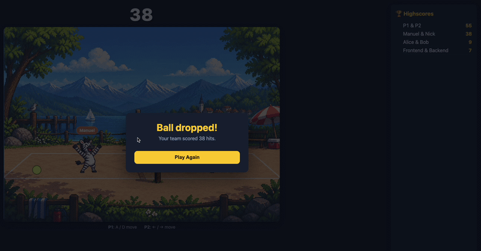

# Simple game for the future day

The files at root are meant to be read and edited by children and people who do not have a technical background. That is why the code and comments are in german.

# How to play:

1. head over to [releases](https://github.com/jobcloud/future-day-frontend-vs-backend-game/releases)
2. download game.zip from the latest release
3. unzip and open index.html in the browser

# How to build

1. run `. ./build.sh`
2. create a new release on [releases](https://github.com/jobcloud/future-day-frontend-vs-backend-game/releases) and add the generated `game.zip`
